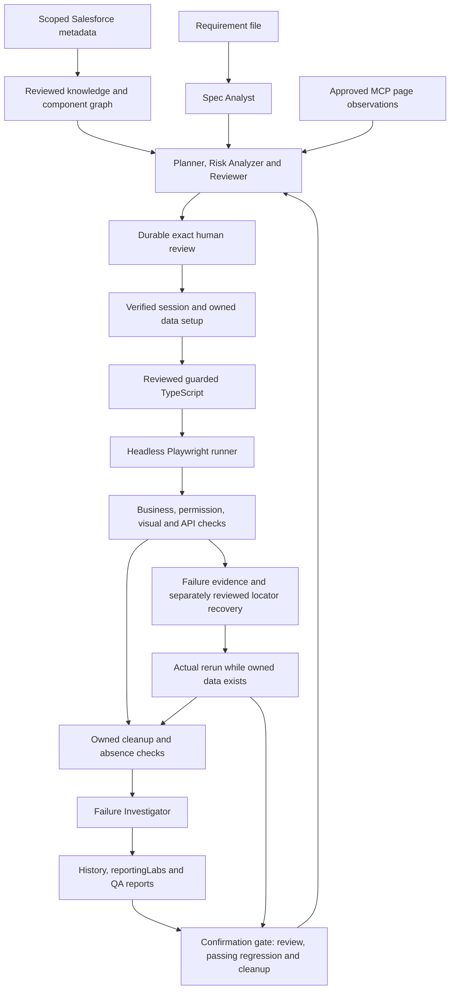

# SalesforceAgenticQA: the complete framework guide

## Milestone 1: reuse the confirmed session input

**AUTH BLOCKED** — see [the authentication audit](MILESTONE_1_AUTH_AUDIT.md). Diagnostic027 is consumed and already recorded INVALID_SESSION_ID for the older API-origin browser cookie. A new independently approved normal-login export, saved November20 at5:52:40 p.m. IST, has now been confirmed by the operator. Its separate scoped028 copy imports exactly offline with zero requests. No fresh server proof or E2E pass is claimed. The historical “input unavailable” sections below no longer describe input availability.

The next concrete operator decision is the inactive read-only Account/Contact review in `.state/lifecycle-readiness-20261120-028/REVIEW.html` or `REVIEW.md`. It uses the existing headless local Chrome/MCP services, unchanged approved visible-view contracts and independent record comparisons, followed only on success by bounded metadata/permission/cleanup-access reads. Exact original expiry, latest-start time and final hashes are in that local review. Approval must cover scoped input/read-only execution and separately native background-effects/access risk. Nothing activates from an export confirmation or this guide. No factory/create/delete/cleanup/final-run authority is granted. Do not run activation/execution recipes without the exact explicit operator decision.

No browser identity assertion was removed: both origin cookies must independently prove the exact org/user, actual cookies must match, and engine/app/build/source gates remain. SOAP is a conditional fixed identity fallback, not ordinary business write access. After live AUTH VERIFIED, the existing synthetic factory/generated-test/SOQL/owned-cleanup/reportingLabs pipeline needs fresh separate business/native/final consent and current pre-creation readiness. Waiting for approval cannot renew a consumed run or extend a stale15-minute receipt.

## Executed 027: INVALID_SESSION_ID confirmed; fresh browser input unavailable

[Actual result and next prerequisite](PREFLIGHT_027_RESULTS.md): exact retained-input/content/read-only/native-risk consent ran027 once on November20 at17:47:21-17:47:27IST within original deadlines. One JWT/six GETs returned HTTP200; exact API identity, active user and selected app passed with no framework denial. Native API-origin SOAP getUserInfo returned HTTP500, and the bounded parser retained recognized code INVALID_SESSION_ID. This classifier path is LIVE verified; other codes/hints/adversarial cases remain offline verified. No narrower hint was recorded, so expiry, malformed input, API-use restrictions or app configuration are not established as the specific cause.

The current blocker is rejection of the API-origin browser cookie for SOAP identity proof. Both browser-disposal stages passed and preserved primary evidence. No remaining native identity completion, final actual-cookie/build proof, Page/JavaScript/Aura/MCP/images, business-record reads/writes, generated live tests/factory/owned cleanup/reportingLabs or verified lesson.027 is consumed and cannot replay, rebind or renew. No raw XML/messages/credentials/identity values were retained in diagnostic output. Historical026 and earlier missing details are not retroactively inferred.

The user answered **Not available** to a fresh independently approved normal-login export. This is the external blocker. No replacement review, browser grant or data package is prepared. Resume only when a new dedicated-user export is available for local validation and a new exact source/input/content/read-only/native-risk review. Confirmation of an export grants preparation only, never execution. Existing gates and app permissions stay unchanged.

No runtime code changed in this result-recording turn. Reuse exact source-pinned402/402 unit/integration,46 focused,five headless,typecheck/demo/private recipe results from before027; no new suite is claimed or repeated after consent. Local result integrity, protected-value and diff checks cover this delivery. The user discovery edit remains unchanged/excluded. All 15 responsibilities and cumulative P0/P1/P2/integrations/normal-Production/ownership/learning requirements remain preserved. Older sections retain historical status.


## Inactive 027: bounded SOAP fault classification requires new consent

Source-bound `SFQA-DIAG-20261120-027` is **INACTIVE** after all offline checks. It explicitly reuses unchanged `.auth/qa-user-scoped-20261120-025.json` from the **November 20, 1:22:30 p.m. IST** export. This is not a new login or working-session claim.026 identified API-origin SOAP getUserInfo HTTP500 at4:54p.m.IST; its actual fault code remains unknown. The new purpose is bounded local classification of a failed SOAP response, with no historical body recovery.

Review: `.state/lifecycle-preflight-SFQA-DIAG-20261120-027/REVIEW.html` (or `REVIEW.md`), `plan.review.json` and `manifest.review.json`. Proposed activation: `cf5be4510baf183eb8bf2612848fcd4414e0ab385a4945f0f6d5e8b319ccd835`; read-only policy: `10c1135c0df3c5b39f02d52a32d0c3d4a1ba1116d347b96b8fdbed256b863cb5`. Original expiry: **November 20, 2026, 6:15:47.079 p.m. IST**; execution must start **before 6:10:47.079 p.m. IST**. The new55-minute review window and five-minute reserve preserve the one-hour limit and renew no earlier grant.

Same exact QA org/user/persona/origins/app/build/engine and fixed preflight request scope: at most one JWT, six metadata GETs and five native proof calls (conditional read-only SOAP getUserInfo POST included), two isolated installed headless Chrome verification browsers, five minutes total and existing request timeouts/phase checks. Failed SOAP HTTP400-599 alone may trigger a one-second buffered-body read and16KiB/128tag/24level classification. Only a closed class, allowlisted code and optional reported-message label persist; no raw XML/messages/URLs/headers/cookies/tokens/identity values or uploads. The parse cap is not a hard HTTP-transfer cap. Redirect bodies remain unread. A classification does not authenticate, prove the exact cause, retry, refresh, substitute JWT, or change permissions.

The new SOAP-content/minimization consent flag is false by default and mandatory before execution, alongside exact retained-input/read-only/native-effects/access approval. No Page/JavaScript/Aura/MCP/images, business-record reads/writes, actions, factories, owned cleanup, AI or E2E authority. Native effects may be undocumented/irreversible; checks cannot undo in-flight effects. Changed input/source or failed proof stops without replay/rebinding/renewal.

Code verified in `d49c5f6`:402 full tests,46 focused,five headless,typecheck/demo/private recipes PASS before review creation. Local exact source/input/history/date/hash/consent-flag and ordinary-Production/cross-org/user/data/altered-input/path negatives passed; empty-context headless HTML used zero HTTP. Approved files/intents/live calls are zero.026 remains consumed and its outcome unchanged. The SOAP parser is OFFLINE verified only; no live fault code or verified Salesforce lesson is claimed. All 15 responsibilities and cumulative P0/P1/P2/integrations/safety boundaries remain preserved. Older sections retain historical status.


## Executed 026: SOAP/API-origin/500 identified; fault-code parser offline

[Actual result and source-backed follow-up](PREFLIGHT_026_RESULTS.md): exact approved026 ran once on November20 at16:54:31-16:54:37IST within original deadlines. One JWT/six GETs all HTTP200; API identity/active-user/selected-app passed, with zero framework denial. Native context-identity failed identity-http and retained operation soap-get-user-info, sessionOrigin api and HTTP500. This closed operation/status telemetry is LIVE verified. SOAP fault code/message were not retained; underlying server cause remains unknown. Both disposal stages passed. No final cookie/build proof, Page/MCP/images, record read/write, generated live tests/factory/owned cleanup/reportingLabs/lesson.026 is consumed; no replay or state rebind.

The existing verifier now has OFFLINE-only bounded SOAP classification for failed HTTP400-599: a one-second diagnostic body read,16KiB/128tags/24levels parse cap, no DTD/entities, no raw body or message retention. Only closed classification, allowlisted exception codes and two reported-message labels may persist; these do not independently prove expiry or effective permissions. Unknown/malformed/excessive data stays unclassified, body-read errors preserve the original failure, and redirect bodies remain unread. Request shapes/counts, auth assertions, redirects-disabled, request/session budgets and all normal Production boundaries are unchanged. No automatic login/refresh, JWT substitution, permission change or retry. The classifier has not run against Salesforce and cannot recover026's discarded body.

Final SOAP-fault validation: typecheck PASS; **402/402 unit/integration tests** (599110 ms; zero failures/skips), **46 focused tests**, **five headless tests** (25.7s), required demo and private recipe typecheck PASS. Unsafe XML, unknown/conflicting codes, protected-field injection, read failure/timeout and unread redirects were exercised offline. Original026 evidence and the user discovery edit remain unchanged; the edit is excluded from commits. The SOAP classifier has not run against Salesforce. No additional live Salesforce/Gemini/Chroma call, automatic session recovery, permission change or verified lesson occurred. All checks precede any new final review window. All 15 responsibilities and cumulative P0/P1/P2, Gemini/RAG, LangGraph/MCP/Chrome/reportingLabs, ownership/cleanup and verified-learning boundaries remain preserved. Older sections below retain historical status.


## Inactive 026: classify the native proof with closed evidence

After all required checks passed, source-bound `SFQA-DIAG-20261120-026` was prepared **INACTIVE**. It explicitly reuses the unchanged confirmed `.auth/qa-user-scoped-20261120-025.json`, from the November20 **1:22:30 p.m. IST** export. This is **not a refreshed export or a working-session claim**:025 failed native identity-http at3:36p.m.IST, with the original operation/status unavailable. The new purpose is to capture fixed native-proof operation, api/lightning session-origin class and numeric HTTP status using the tested telemetry. A failure classification alone does not prove expiry or a Salesforce defect.

Review: `.state/lifecycle-preflight-SFQA-DIAG-20261120-026/REVIEW.html` (or `REVIEW.md`), `plan.review.json` and `manifest.review.json`. Proposed activation: `9daffc013080573e49492521fb3a4ad4186e6c0f01d330f21767c8759bdc0c2e`; read-only policy: `10c1135c0df3c5b39f02d52a32d0c3d4a1ba1116d347b96b8fdbed256b863cb5`. Original expiry: **November20,2026,5:05:22.520 p.m. IST**; execution must start **before5:00:22.520 p.m. IST**. The new55-minute window/five-minute reserve preserve the existing one-hour limit and renew no previous grant.

Same exact org/user/persona/origins/app/build/engine and preflight request semantics: at most one JWT, six exact metadata GETs and five fixed native proof requests (conditional read-only SOAP getUserInfo POST included), two isolated installed headless Chrome verification browsers, five-minute scope and existing request timeouts/phase checks. No Page/JavaScript/Aura/MCP/images, record read/write, action, factory, cleanup, AI or E2E authority. Native session effects may be undocumented and irreversible; checks cannot undo in-flight effects. New exact retained-input/read-only/native-effects/access consent is required. Changed input/source or failed proof stops; no replay, rebind or renewal.

Code verified in `55fffb2`:399 full tests,43 focused,five headless,typecheck/demo/private recipes PASS before review creation. Local exact hash/provenance, ordinary-Production/cross-org/user/data/altered-input/path negatives and empty-context headless review HTML passed; approved files/intents/live calls are zero.025 remains consumed; its original outcome and all earlier declined/expired/consumed scopes are unchanged. No new factory package or verified Salesforce lesson. All 15 responsibilities and cumulative P0/P1/P2/integrations/safety boundaries remain preserved. Older sections below retain historical status.


## Executed 025: native HTTP failure; closed proof telemetry added offline

[Actual result and correction](PREFLIGHT_025_RESULTS.md): separately approved025 executed once on November20 at15:36:04-15:36:09IST, within its original deadlines. One JWT and six GETs returned HTTP200; exact API org/user, active-user and selected-app gates passed with no framework denial. Installed headless Chrome/context setup passed. Native context-identity failed with identity-http/session-or-scope; both browser-disposal stages passed. No final cookie comparison, native build proof, record read/write, Page/MCP/image/generated live test/factory/owned cleanup/reportingLabs/lesson.025 is consumed and cannot replay. Its actual native endpoint/status/server cause were not retained and remain unknown. Export age alone does not establish expiry.

The existing diagnostic stage now accepts optional nativeProof metadata: a fixed operation enum, api/lightning session-origin class and numeric HTTP status, absent before a response. No raw URLs, cookies, tokens, headers, bodies or identity values. Error wrapping/disposal and observer-free or legacy-observer paths retain this closed evidence; old saved rows remain readable and failure summaries stay compatible. Request shapes, fallbacks, redirects-disabled, timeouts and independent identity assertions are unchanged, with no extra requests. Mocked branches distinguish userinfo, SOAP, HTML and transport failures without claiming a live025 status. Partial test responses were corrected to include Playwright's required status() method; their assertions and budgets stay unchanged.

Final offline verification: typecheck PASS; **399/399 unit/integration tests** (542157 ms; zero failures/skips), **43 focused tests**, **five headless tests** (18.7s), required demo and private recipes typecheck PASS. The initial full run was392/399: six incomplete response-double failures and one fixture frame-load setup timeout. Corrected API doubles and deterministic pre-observation DOM setup passed the complete rerun; assertions, locator/session budgets and stability requirements were unchanged. Initial logs are retained. New telemetry remains OFFLINE verified only; no additional Salesforce/Gemini/Chroma call or verified lesson. The user discovery edit is preserved/excluded. All checks precede any new final review window. The telemetry is OFFLINE verified only; no additional live call is authorized by code changes. All 15 responsibilities, cumulative P0/P1/P2, Gemini/RAG, LangGraph/MCP/Chrome/reportingLabs and safety/ownership/cleanup/learning boundaries remain in scope. Older sections below retain historical status.


## Inactive 025: confirmed export, exact review pending

The user confirmed a refreshed export after consumed024. Local file time is November 20, 2026, **1:22:30 p.m. IST**; its current server-side validity is still unknown. Separate private copies exclude 32 cookies and one origin outside the existing exact scope. No expired cookie was removed. All 11 retained cookies, mandatory sessions and allowed origins are unchanged, and their exact offline import through installed headless Chrome passed. The original export and consumed024 files remain unchanged. No new Salesforce call, state rebinding, record operation or data package occurred.

Fresh source-bound `SFQA-DIAG-20261120-025` is **INACTIVE**. Review: `.state/lifecycle-preflight-SFQA-DIAG-20261120-025/REVIEW.html` (or `REVIEW.md`), `plan.review.json` and `manifest.review.json`. Proposed activation: `82f5fe14f40b7c272cfb7bbff0982eb44a249f59c9a56e7e20a5c67519c21960`; read-only policy: `10c1135c0df3c5b39f02d52a32d0c3d4a1ba1116d347b96b8fdbed256b863cb5`. Original expiry: **November 20, 2026, 3:52:37.538 p.m. IST**; execution must start **before 3:47:37.538 p.m. IST**. The new 55-minute review window, five-minute reserve and existing one-hour security limit do not renew any earlier grant.

Scope remains one source-bound preflight: at most one JWT, six exact identity/active-user/selected-app GETs and five fixed native proof requests, including conditional read-only SOAP getUserInfo POST. Two isolated installed headless Chrome verification browsers, five-minute diagnostic scope, existing timeouts and phase checks. No Page, JavaScript/Aura/MCP/images, business-record reads/writes, actions, factories, cleanup, AI or E2E authority. Native session requests may have undocumented irreversible effects; checks cannot undo in-flight effects. Fresh exact input/read-only/native-risk/access consent is required before execution. A changed source/export or failed proof stops without replay, rebinding or renewal.

New local validation: private recipes typecheck, exact input provenance/import, review hashes, normal-Production/cross-org/user/data/altered-input/path negatives and offline headless HTML all passed. Approved files and execution intents are zero. The unchanged runtime reuses source-and-log-hash-verified **396/396 unit/integration, five headless, typecheck and demo** evidence from before024; those suites were not rerun or claimed as new results. Earlier intermittent fixture failures remain documented.024 stays consumed with identity-redirect; its endpoint/destination/server cause remains unknown, and neither live cookie comparison nor build proof passed. The earlier automatic-review usage failure executed nothing; subsequent local preparation used the normal approval path after it became available. All 15 responsibilities, cumulative P0/P1/P2 and existing integrations/safety/ownership/learning remain preserved. Older sections below retain their historical status.


## Executed 024: API checks passed; native identity redirected

[Actual diagnostic 024 result](PREFLIGHT_024_RESULTS.md): exact normalized-input/read-only/native-risk consent executed once on November 20, 13:14:45–13:14:51 IST, within original deadlines. One JWT and six GETs returned HTTP 200; exact API org/user, active-user and selected-app checks passed with zero framework denials. Local state/source authorization, installed headless Chrome launch and context creation passed. The first failed stage was native context-identity, reason identity-redirect, category session-or-scope; redirects were not followed. Both observed browser-disposal stages passed and preserved the primary reason. The exact native endpoint/status/destination and underlying server cause were not retained; expired/revoked session or wrong identity is not established.

Final actual-cookie comparison and native build proof did NOT execute. The expiry normalizer remains offline verified, without a live comparison pass from this attempt. No business-record reads/writes, Page/JavaScript/Aura/MCP/images/generated live tests/factory/cleanup/reportingLabs/verified lesson; no readiness receipt. Native background effects are not enumerated.024 is consumed, failed-or-uncertain-no-replay, even before its original expiry. Original signed reviews, deadlines and earlier consumed/declined scopes remain unchanged.

No runtime code changed. Reuse the source-pinned pre-approval396/396 unit/integration, five headless, typecheck/demo/private recipe evidence; no new suite is claimed or repeated after consent. Earlier intermittent fixture failures remain documented. Current delivery checks cover local integrity, protected values and diff only. Next input: a fresh independently approved dedicated-user normal-login export; confirmation permits preparation only, with new exact read-only/native-risk consent required before another call. No replacement review or data package has been prepared. All15/P0/P1/P2 and existing integrations/safety/ownership/learning requirements remain preserved. Older sections below retain historical status and confer no current authority.


## Fresh inactive diagnostic 024: single next operator decision

After required offline validation, source-bound `SFQA-DIAG-20261120-024` was prepared INACTIVE. Review: `.state/lifecycle-preflight-SFQA-DIAG-20261120-024/REVIEW.html` (or `REVIEW.md`), `plan.review.json` and `manifest.review.json`. Proposed activation: `a8ae40f052acd90037d86083359fa7acd369763ff43469b0822e39eefb375a68`. Separate read-only policy: `10c1135c0df3c5b39f02d52a32d0c3d4a1ba1116d347b96b8fdbed256b863cb5`. Original expiry: **November 20, 2026, 1:27:06 p.m. IST**; execution must start **before 1:22:06 p.m. IST**, retaining the five-minute reserve and unchanged one-hour security limit. No renewal or replay.

The new copy removes only the one expired non-session entry omitted by Chrome. Mandatory sessions, all other retained values/flags and origins are unchanged; original state files and grants remain unchanged. Exact input/source bindings and offline import passed. The recipe requires explicit normalized-input approval plus read-only execution/native-effects/access consent; current server validity/build proof remain unverified until fresh execution. Maximum one JWT, six exact identity/active-user/selected-app GETs and five fixed native proof requests (conditional read-only SOAP getUserInfo POST included), two isolated headless installed-Chrome verification browsers, five minutes total. No Page, JavaScript/Aura/MCP/images/business-record reads/writes/factory/cleanup/AI or E2E authority. Native session requests may have undocumented irreversible effects; checks cannot undo in-flight effects.

Local audit passed exact hashes, normal-Production/cross-org/user/data/altered-state/path rejection and local headless review HTML with zero external requests. Approved files and execution intents: zero. No new live call. Code verified in `cb2849d`; all expensive checks preceded review creation.023 is consumed;018 and earlier declined/expired/consumed scopes stay unchanged. Fresh exact operator consent for024 is the only next decision; the complete lifecycle remains separately gated.


## November 20: diagnostic 023 consumed; expired-cookie mismatch confirmed

[Actual result and correction](PREFLIGHT_023_RESULTS.md): one JWT/six GETs HTTP200, exact API identity, active user, selected app and both native-origin session identity proofs PASS live. The next exact loaded-context comparison failed with context-identity/context-state-mismatch: Chrome omitted one non-session cookie already expired at11:13:16IST. Offline real headless Chrome reproduces source15/import14 with all retained entries and mandatory sessions unchanged. Build proof/Page/MCP/images/business-record reads/writes/generated live tests/cleanup/reportingLabs NOT EXECUTED. No new readiness receipt or verified lesson.023 is consumed; original outcome/grants unchanged.

A proposal-only normalizer creates a separate review-required state copy, rejecting expired/missing mandatory sessions, foreign scope and ordinary Production modes. No source overwrite, runtime comparison relaxation, silent rebinding or automatic activation. The same expired-input condition is reconstructed in018, but its original first exception remains unobserved. Final correction validation: typecheck PASS;396/396 full unit/integration tests (596326ms), zero failures/skips;5/5 headless tests (1.1m); required demo PASS; private recipes typecheck PASS. Four focused normalization tests passed, including real offline Chrome import. Two earlier full runs each had394/396 passing, with different existing browser-fixture failures (runner budget/pipeline, then remount-readiness/MCP adapter). Follow-ups retained one repeated pipeline failure before its instrumented fixture reproduction passed; the19-test readiness/MCP isolation passed unchanged. Those failures/logs remain retained; their cause is unconfirmed. No assertion, test/session budget or security check was weakened to obtain this complete passing rerun. User discovery edit is preserved/excluded. No new Salesforce/Gemini/Chroma call during correction; all validation precedes the new inactive review window. All cumulative15/P0/P1/P2 rows, Gemini001/RAG/LangGraph/MCP/Chrome/reportingLabs, safety, ownership and cleanup requirements remain preserved.

Older sections below retain their historical preparation/result status; they are not current authority.


## Latest actual preflight result

Next inactive review: `SFQA-DIAG-20261120-023` at `.state/lifecycle-preflight-SFQA-DIAG-20261120-023/REVIEW.html`. Exact activation `b63e90987ebc80de1964d6331434ddd636eb66223da71417c0b23f987a02569b`; original November20 expiry12:18:23p.m.IST, latest start12:13:23p.m.IST. It uses corrected canonical paths and the same bound export, without adding an operation, business-record read or mutation. Fresh exact read-only/native-risk consent is required. All392 tests/five headless/typecheck/demo passed before creating this review. Do not rerun022; no new execution or data grant is active.

[022 result](PREFLIGHT_022_RESULTS.md): fresh API identity passed, then a framework exact-path mismatch blocked the actor query before dispatch. The generator left literal apostrophes while the actual client encoded them as%27. A shared canonical proposal helper is offline verified without widening scope.022 is consumed; selected-app/native/browser/E2E checks did not execute.018's older cause remains unresolved. No data effects or new business authority. A new source-bound review requires separate consent after validation; never retry022 or reuse its original deadline.

## Historical inactive022 review, superseded by its consumed attempt above

[Lifecycle018 investigation](PREFLIGHT_018_INVESTIGATION.md) records the confirmed offline diagnostic corrections and391/five-headless/typecheck/demo results. The refreshed export is now separately scoped and bound to inactive `SFQA-DIAG-20261120-022`: `.state/lifecycle-preflight-SFQA-DIAG-20261120-022/REVIEW.html`. Activation hash `35777c0259b8673e37e6642cdd2f504818c3db6ad6373a3a59f399301c2b6214`; original November20 expiry **11:29:59IST**, latest start **11:24:59IST**. Exact read-only/native-risk consent is required; no live call, factory or approval has occurred. The minimum scope verifies identity/actor/app/native cookies/build without business-record reads or UI execution. It grants no lifecycle authority and cannot replay018 or renew old readiness.

## Latest live boundary: readiness passes; final data lifecycle still incomplete

[November19 actual outcomes](LIFECYCLE_018_RESULTS.md): separately authorized021 passed both real Account and Contact reviewed visible readiness, real Chrome/MCP and unchanged-record comparisons. Separately business/native/final-approved018 executed once but failed before factory reservation or creation. Journal reconciliation confirms zero created/active/uncertain effects. Its exact preflight exception was not retained, so the cause remains unresolved. No generated live test, post-creation SOQL, cleanup or live reportingLabs result may be inferred.

The existing preflight now persists sanitized API/context/identity/build stage evidence, verified offline without Salesforce calls. This adds diagnostic evidence only. Do not rerun the private018 activation/execution recipes, reuse its approvals, renew its deadlines or infer authority from successful021 receipts. Any new run needs its own exact consent and current gates. Historical002/012 remain declined. Local reports: `artifacts/lifecycle-readiness/SFQA-PREFLIGHT-20261119-021/index.html` and `artifacts/live-lifecycle/SFQA-E2E-20261119-018/postmortem.html`; local masked images stay private. No further Gemini/RAG validation was run. All15 responsibilities/P0/P1/P2 and prior architecture below remain preserved.

Final verification: typecheck PASS; 372/372 full unit/integration tests (725321 ms), zero failures/skips; required offline demo PASS; 5/5 headless tests (37.7 seconds); focused sanitized preflight cases 4/4; local postmortem HTML PASS with zero external requests. These tests use offline Salesforce/model fixtures; the diagnostic change has not run live. No extra Salesforce/Gemini/Chroma calls. User discovery edit preserved and excluded.

**Historical019 result, superseded by021 above:** [019 live Account PASS / Contact BLOCKED](LIFECYCLE_READINESS_019_RESULTS.md). Both sessions verified identity/build/state and unchanged records. Contact's visible name/tabs passed; one off-viewport related-list busy signal blocked its strict readiness contract. The proposed Contact viewport rule remains inactive and requires review. Fresh021 also remains inactive, original November19 22:29:15IST expiry. No business records, generated live tests, factory package or verified learning. The single next decision combines exact Contact-rule review with fresh read-only/native-risk scope; full lifecycle remains separately gated.

**Earlier preparation, superseded by executed019 above:** [Fresh inactive019](LIFECYCLE_READINESS_019.md) binds the user-confirmed refreshed export, validated separate scoped copy and tested readiness source hashes. Original expiry November 19 **22:01:46 IST**. No approved files, Salesforce calls, browser sessions or writes; input confirmation is not execution consent. 017 remains expired/unexecuted. The single next decision is exact read-only/native-risk authorization for019; the complete lifecycle remains separately gated.

**Earlier 017 expiry gate, superseded by 019 above:** 017 received exact consent but its execution-time check occurred after the original 19:21:44 IST expiry; it remained unactivated/unexecuted. No Salesforce call, browser session, business write or automatic replacement. Fresh checks passed: 368 unit/integration, five headless, typecheck and demo. The next input is a fresh approved QA export or an explicit existing-copy choice for a new inactive review. [Actual expiry audit](LIFECYCLE_READINESS_015.md#single-next-operator-decision-inactive-source-bound-review-017). Live readiness and the final lifecycle are still blocked; historical browser/Gemini evidence is not renewed authority.

**Historical preparation, now expired:** [Inactive read-only 017](LIFECYCLE_READINESS_015.md#single-next-operator-decision-inactive-source-bound-review-017) binds the tested readiness source hashes, original expiry November 19 19:21:44 IST. No new service call, grant activation or data package. Final checks after correction: 368/368 unit/integration, five headless tests, typecheck and demo passed. Live readiness and the synthetic lifecycle remain blocked pending separate current evidence and consent.

**Latest actual result:** [Preflight 015](LIFECYCLE_READINESS_015.md) passed fresh browser identity/build/app/state and actual MCP navigation, then readiness timed out. Account unchanged; four local masked images retained; Contact and the data lifecycle did not run. A locally reproduced locator-remount race was corrected through element snapshots without changing assertions or budgets. The correction is offline verified, not yet live verified. Consumed 015 cannot replay, and no final data package is prepared or approved. All prior requirements remain in scope.

**Earlier preparation, superseded by executed 015 above:** the refreshed export has now been independently minimized into a new scoped copy. Read-only preflight 015 is prepared/inactive until its separate exact consent, original expiry November 19 18:24:41 IST. Its review and hash are in [the current handoff](LIFECYCLE_READINESS_014.md#refreshed-input-and-single-next-operator-decision). Server session validity is still unproven; no 015 Salesforce call, factory or final lifecycle approval occurred. The earlier 014 failure remains immutable.

**Earlier 014 result:** [Read-only prerequisite 014](LIFECYCLE_READINESS_014.md) passed fresh API/schema/permission-flag/cleanup-read/metadata checks but stopped at native browser `identity-http` on November 19, 17:19 IST. Account pre/post was unchanged; no page, Contact observation, data write or generated live test occurred. The failed attempt cannot replay. Refresh the dedicated user's approved export as the next input; a new exact inactive review and separate execution consent must follow. Expired 013 is unchanged; 002/012 stay declined. The new owned-record MCP selector option and journal-scoped native navigation fix passed offline Chrome/MCP regressions, not a live lifecycle. Current checks: 366 unit/integration and five headless tests, typecheck and required demo passed.

**New lifecycle review:** [LIVE_LIFECYCLE_REVIEW.md](LIVE_LIFECYCLE_REVIEW.md) covers the separate inactive Account/Contact package, exact fields, generated proposals, business/native-risk approvals and fresh readiness gates. `lifecycle-review-check` audits saved artifacts only; PASS does not mean live execution is authorized. No live call, data mutation, activation or upload occurs during preparation. 012 remains declined and 005 consumed.

**Latest live milestone:** [Account observation 005 passed](ACCOUNT_OBSERVATION_REVIEW.md) through the integrated goal-directed adapter in actual headless local Chrome/MCP on November 19. Exact identity/build/state, real name/heading/Related/Details, reviewed visible readiness, four local masked images and independent unchanged-record checks passed. The earlier Gemini retrieval benchmark also passed and was not repeated. Older inactive/failure handoffs below remain historical; the completed runs cannot replay, and no synthetic-data lifecycle is authorized by either result.

For the earlier transition to actual services, read [LIVE_INTEGRATION_READINESS.md](LIVE_INTEGRATION_READINESS.md). It separates historical proof, local configuration checks and fresh authorization gates, with practical commands. Those inactive drafts were not permission to run. Later exact authorizations and executed results are summarized above and in chapter 24; declined scopes remain inactive.

## 1. What this project is building

SalesforceAgenticQA is building an AI QA engineer for Salesforce. Its goal is **Specs In → Tests Out → Failure Intelligence → Verified Learning**. You give it a requirement. It uses available Salesforce evidence to propose tests, explains what it does not know, runs only approved work and keeps evidence of the result.

It is a Windows-friendly TypeScript project. It uses installed local Chrome, or Edge when Chrome is unavailable, in headless mode. It does not need Docker, Python, a remote browser or your everyday browser profile.

The framework has substantial working services. It is not yet an unrestricted human replacement. A proposed scenario is not an approved test. A passing mock is not a passing Salesforce integration. Metadata is not proof that a business rule executed. These distinctions appear in the reports.

The connected local demonstration uses **real generated Playwright tests, real local Chrome, real MCP observations, real SQLite checkpoints and real reportingLabs files**. Salesforce API/data and Gemini HTTP responses are mocked. No configured live credentials are used by that demonstration.

## 2. The 15 responsibilities

An “agent” is a responsibility with typed inputs, outputs and allowed tools. This does not mean 15 independent chat sessions are running. Services exchange TypeScript objects, source references, graph state and journaled evidence. Optional Gemini advice is a proposal; it does not own approval decisions.

| Responsibility | What it does | Main source |
|---|---|---|
| Orchestrator | Connects the phases and maintains graph state | `src/agents/pipeline.ts`, `src/execution/dedicated-pipeline.ts` |
| Spec Analyst | Imports criteria, actors, conditions and missing requirements | `src/specs/ingest.ts`, `src/agents/spec-intelligence.ts` |
| Org Discovery | Reads allowed schema and component evidence | `src/agents/org-discovery.ts`, `org-intelligence.ts`, `deep-discovery.ts` |
| Application Explorer | Observes pages, locators, states and reviewed transitions | `src/agents/fixture-explorer.ts`, `application-intelligence.ts` |
| Knowledge Agent | Stores and retrieves scoped, source-linked knowledge | `src/knowledge/index.ts`, `rag.ts`, `reviewed.ts` |
| Test Planner | Builds source-grounded scenarios and review questions | `src/agents/test-design.ts`, `qa-intelligence.ts`, `workflow-planning.ts` |
| Risk Analyzer | Follows component dependencies and confirmed history | `src/agents/component-graph.ts`, `quality.ts` |
| Test Data Agent | Plans dependencies, creates approved data and tracks ownership | `src/agents/hybrid-factory.ts`, `data-execution.ts`, `src/salesforce/dedicated-qa.ts` |
| Test Generator | Turns reviewed workflows into TypeScript | `src/agents/workflows.ts` |
| Test Reviewer | Checks source versions, outcomes, prerequisites and approvals | `src/agents/workflow-models.ts`, `qa-oracles.ts`, `application-intelligence.ts` |
| Execution Coordinator | Applies session/data gates and invokes the real runner | `src/execution/readiness.ts`, `runner.ts`, `browser-guard.ts` |
| Failure Investigator | Correlates failures, traces and historical defects | `src/agents/intelligence.ts`, `exploration-investigation.ts` |
| Self-Healing | Proposes a reviewed locator-only repair and reruns it | `src/agents/healing.ts`, `exploration-recovery.ts` |
| Autonomous Explorer | Chooses among bounded, approved goals and actions | `src/agents/exploration-plan.ts`, `exploration-runtime.ts`, `exploration-ledger.ts` |
| Learning Agent | Promotes a defect only after confirmed evidence and a passing regression | `src/agents/intelligence.ts`, `src/core/history.ts` |

All original P0/P1/P2 requirements remain in [FEATURE_MATRIX.md](FEATURE_MATRIX.md). The current integration map and remaining connections are in [FRAMEWORK_INTEGRATION_AUDIT.md](FRAMEWORK_INTEGRATION_AUDIT.md).

## 3. Architecture and source map



`pipeline.ts` is the general specs graph. `dedicated-pipeline.ts` owns the separate dedicated-org lifecycle and its stronger live session/ownership gates. `workflow-planning.ts` owns source-linked workflow review. The new integration reuses these services. It does not replace them with another agent framework.

The general graph now preserves host-supplied QA guards when it regenerates tests after data setup. Optional trusted runtime hooks prepare the reviewed configuration, perform post-execution checks and independently verify cleanup. The same graph can stop at an exact execution-review interrupt and resume from the existing durable saver.

`src/demos/integrated-framework.ts` composes the real services for the local fixture. `fixtures/integrated-salesforce.ts` is its mock data/API backend. `src/execution/fixture-qa-guard.ts` is a closed loopback adapter for the generated child process. It accepts only fixture evidence, fixed synthetic identity, reviewed preview actions and actual run-owned journal entries. It cannot be used as a Salesforce browser mode.

## 4. Run the connected example

Open PowerShell in the repository root:

```powershell
node --version
npm.cmd ci
npm.cmd run doctor
npm.cmd run demo:framework
```

Node 22 or later and installed Chrome/Edge are required. The doctor checks local prerequisites and reports configuration presence. **It does not test Salesforce, Gemini or Chroma connectivity.** It never prints keys or tokens. Install a local Chrome/Edge browser if none is found; a compatible installation is used without downloading a Playwright browser.

The demonstration does the following in one connected composition:

1. Imports `fixtures/integrated-account-contact.json` through the actual requirement importer.
2. Runs discovery with a mocked Describe reader and builds source-linked metadata/validation evidence.
3. Observes seven preview cases using headless Chrome and same-context Playwright MCP. The application study selects one observed Account page and one Contact page; the full QA observations retain every case.
4. Stores reviewed declarations locally, obtains embeddings through the actual Gemini adapter with injected mock HTTP and proves retrieval after reopening SQLite. Gemini reasoning also uses the real adapter with mock HTTP and Zod validation.
5. Stops at workflow review, reopens its checkpoint and resumes with the exact synthetic fixture review.
6. Runs the existing specs graph, stops again before execution/data setup, reopens the checkpoint and resumes the exact execution review.
7. Uses the real HybridFactory: Account uses the API adapter and Contact uses a reviewed business-service adapter. Both adapters operate only on the mock backend. Deterministic values and the Contact parent are independently checked.
8. Captures and separately reviews a masked fixture baseline. Builds business, permission and visual checks through the existing QA planner.
9. Executes seven generated TypeScript files in an actual Playwright child process. Each keeps its original assertion and adds reviewed QA checks with an independent read adapter.
10. Verifies owned data after the browser work, deletes Contact before Account and independently checks absence. An unrelated synthetic sentinel must remain unchanged.
11. Runs a fresh fixture phase with deliberate API, locator and layout faults. The three tests must fail and cleanup must still complete.
12. Observes the changed locator using MCP, reviews a typed locator repair and runs the existing healer against the actual guarded source. It does not change the expected text.
13. Publishes one fixture automation lesson only after actual failing evidence, a passing repair regression, named cause/fix review and verified cleanup. The next source-grounded plan must raise the regression priority.

The success phase should show seven passing tests. The faults phase should show three intentional failures. The repair should pass. A top-level verified demonstration means these expected outcomes and safety checks occurred; it does not hide the failed tests or call the fault phase successful.

## 5. Find the output and inspect history

Each run prints exact paths and creates a fresh folder:

```text
artifacts/framework-<uuid>/
  manifest.json                 shared integration evidence and exact paths
  index.html                    framework summary with local report links
  history.sqlite                execution, mutation, source, QA and learning journals
  success/                      QA design, review files and checkpoint databases
    fw-<uuid>-success/execution/ generated tests, traces, JSON/JUnit/HTML, reporting-labs/
  faults/                       expected failing tests and recovery evidence
    repair-execution/           actual passing repair and reportingLabs output
  future-plan/                  learned regression priority and reviewed proposals
```

Masked images remain under `artifacts/browser-debug/<run>/`. The manifest points to the concrete reports. `.state/framework-latest.json` is a pointer to the latest completed demonstration, not an execution grant.

```powershell
npm.cmd run platform -- framework-status
npm.cmd run platform -- framework-approvals
npm.cmd run platform -- framework-history
$latest = Get-Content -Raw .state/framework-latest.json | ConvertFrom-Json
$run = Get-Content -Raw $latest.manifest | ConvertFrom-Json
$run.runs | Select-Object phase, runId
$run.runs[0].execution.reportingLabs.html
Get-Content -Raw $run.runs[0].execution.reportingLabs.json
```

Open the printed local HTML file in your editor's preview or manually in a browser to read it. Viewing a report does not run a Salesforce workflow. The framework never attaches to or copies an everyday browser profile. For a specific saved run, append its manifest path to the status, approvals or history command.

## 6. Import or select a requirement

```powershell
npm.cmd run platform -- framework-import fixtures/integrated-account-contact.json
npm.cmd run platform -- spec-ingest path/to/your-story.md
```

The first command writes a versioned proposal under `.state/requirements`. It lists missing expected outcomes and grants no authority. Existing importers handle JSON, YAML, text, Markdown, DOCX, PDF and bounded OpenAPI content. Text extraction is not understanding of a document's layout or business meaning. Jira/Azure DevOps connector/import work remains on the roadmap.

Use literal expected outcomes. For example: “An empty draft surname displays `Surname required`.” A statement such as “the system works correctly” is not an executable oracle. Fields, actions, personas, prerequisites and workflows must be supported by evidence and independently reviewed. The supplied Account/Contact file is a synthetic fixture contract; do not reuse its expected labels as live Salesforce business rules.

To review proposals from saved sources:

```powershell
npm.cmd run platform -- test-design .state/test-design-local-input.json
npm.cmd run platform -- qa-intelligence .state/qa-cached-input.json
```

These example manifests must exist and match your saved sources. Missing or stale files should stop or produce review questions. These commands do not create Salesforce records or run a browser. Review the resulting HTML/JSON, source references, unknowns and generated TypeScript before requesting execution.

## 7. Authentication: JWT and StorageState

`src/salesforce/jwt.ts` signs a Salesforce JWT bearer assertion using the configured private key. Salesforce validates the app, user, certificate and audience and returns API access. Safe diagnostics map OAuth failures to guidance without printing credentials. The grant type and security checks remain unchanged.

The configuration template is `.env.example`. Keep your real `.env` and key files local and ignored. Do not paste an assertion, Consumer Key, access token or private key into a report or chat.

JWT API access does **not** prove that a browser is logged in. Browser authentication is separately handled by reviewed UI Bridge/session import and native org/user checks. Playwright StorageState contains cookies and origin state; treat it as a credential. Keep it under `.auth` and outside Git. The session gate checks identity, approved origins, expiry and content binding. A refreshed state file does not renew an expired or consumed approval.

See [BROWSER_AUTHENTICATION.md](BROWSER_AUTHENTICATION.md), [ENVIRONMENT_QA.md](ENVIRONMENT_QA.md) and [DEDICATED_QA.md](DEDICATED_QA.md) for the detailed existing boundaries. Never activate a mode based only on an alias, environment flag or `IsSandbox=false`.

## 8. Local headless Chrome and Playwright MCP

`src/execution/local-browser.ts` detects Chrome and Edge in Windows installation locations, prefers Chrome, pins the selected engine and launches an isolated temporary browser profile. It does not connect over CDP to your everyday browser, use its profile, terminate its processes or silently switch to a remote browser.

Playwright runs generated assertions. MCP lets the Explorer observe the same fixture context through its approved tools. The existing Lightning session architecture shares verification, budgets and action controls in reviewed Salesforce contexts. The local demonstration's exploration context and generated test contexts are separate, deliberately scoped sessions; its MCP and direct observations share the exploration context. It does not claim that every phase uses one persistent browser.

Four permission planes remain separate: platform initialization, read-only observation, reviewed agent interactions and approved business mutations. A normal-network observation is not permission for AI actions, factories or destructive operations. Normal Production policies are unchanged. Native dedicated-org networking carries disclosed background-effects risk and requires its separate exact authorization.

## 9. Metadata and application intelligence

Discovery services collect allowed objects, fields, relationships, record types, validation declarations, Apex, Flows, LWC dependencies, permissions and available sharing evidence using bounded APIs and pagination. `component-graph.ts` records source-backed edges; it never treats a dependency as proof that a branch ran.

Application intelligence adds observed pages, stable locators, states and reviewed transitions. A foreign key does not prove a UI navigation. A visible Account page does not prove a Contact workflow. Unknown or inaccessible behavior remains a question. The current application compiler selects one current page per object for review; the integrated example selects its primary Account/Contact pages and retains all seven separate scenario observations.

The local demonstration exercises these modules with synthetic metadata. Earlier live Salesforce evidence is historical and bounded; it is not refreshed by this command.

## 10. Gemini chat and embeddings

The provider interfaces live in `src/ai/types.ts`; Gemini adapters/configuration/privacy logic live under `src/ai`. Chat and embeddings are separate providers. Keep the existing chat model selection and the separate `gemini-embedding-001` model.

```text
SFQA_MODEL_PROVIDER=gemini
SFQA_MODEL_NAME=<supported chat model already approved for your project>
SFQA_EMBEDDING_PROVIDER=gemini
SFQA_EMBEDDING_MODEL=gemini-embedding-001
```

Configure keys only in your ignored local environment. See `.env.example` for aliases and separate settings. Zod validates structured outputs; timeout, retry, pacing, quota and redaction checks remain in the adapters. Model output cannot introduce unknown scenario IDs, change reviewed outcomes or approve execution.

`npm.cmd run model:check` is an **external connectivity check**, unlike the doctor. Run it only when you intend to contact the configured provider. The integrated demo injects mock transports, uses fixture-only keys and never constructs a live provider from your environment.

## 11. RAG: chunk, embed, store and retrieve

RAG means retrieving useful source evidence before asking a model or planner to reason. `knowledge/index.ts` and `rag.ts` split/normalize documents, retain source/version/org/permission scope, store local lexical/vector data and filter retrieval against the trusted current catalog. The persistent ingestion queue supports bounded batches, content deduplication, pacing, retry/resume and source-version invalidation. Optional Chroma is a remote vector adapter, not a replacement for the local trust catalog.

Reviewed expected rules are stored as **declarations, runtime unverified**. Observations, proposals, confirmed defects and verified lessons are different statuses. Old or foreign-persona knowledge cannot silently force regression selection. The integrated demo reopens SQLite and uses the real embedding adapter with mocked HTTP to test semantic retrieval persistence.

New QA contract publication/planning is local-only by default. Real external embeddings or Gemini reasoning require the existing named review of the exact minimized payload and destination. Redaction is useful but is not a complete DLP guarantee. Do not send raw records, traces or screenshots because an API key is configured.

## 12. LangGraph, checkpoints and approvals

`pipeline.ts`, `graph.ts` and `workflow-planning.ts` use LangGraph. `src/core/checkpoints.ts` persists checkpoint bytes in SQLite. Planning review and exact execution review are different interrupts. The new execution interrupt occurs **before** the data/execution coordinator. It binds the run, full input hash and named reviewer; a wrong response cannot enter setup.

Resuming recreates the graph with the same checkpoint file and thread ID and supplies the exact review through LangGraph `Command`. The connected fixture demonstrates closing and reopening both workflow and execution checkpoint stores. It does not pretend that a crashed browser can be resumed safely. Consumed sessions, uncertain side effects and expired approvals must not be replayed or automatically renewed.

## 13. Test design, generation and explicit execution

The planner supports positive, negative, boundary, integration, permission, regression and visual scenarios when reviewed evidence supports them. Risk uses business impact, source-linked changes and confirmed historical evidence. Missing categories or outcomes become questions.

`workflows.generateTest` generates bounded Playwright TypeScript. The original assertion remains in the test. Optional reviewed QA checks run afterward. The execution host must bind the already approved page, contract versions and independent API/capture adapters. A generated file alone has no authority.

The local fixture command is an explicit request to execute the bundled synthetic fixture reviews. They never authorize Salesforce. For a separately reviewed existing real execution bundle, the existing entry point is:

```powershell
# Example only: do not create or reuse a live bundle from this guide.
npm.cmd run platform -- spec-run .state/approved-run.json
```

The input's exact execution hash, reviewed mappings and the applicable runtime/session/data gates must pass. Do not edit a reviewed file after approval or copy fixture reviews into real inputs. Dedicated live workflows use their existing separately reviewed dedicated pipeline, not the loopback fixture guard.

## 14. Synthetic test data and ownership

Recipes declare discovered fields, API/business-service/UI mode and parent dependencies. `HybridFactory` sorts dependencies, uses the shared deterministic `factoryMutationValues`, records approved mutations through `DataExecution`, verifies creates and registers each record by run. An uncertain effect is not blindly retried. Cleanup uses the run's ownership journal and reverses dependencies.

The demo really executes those services against an in-memory mock backend. It creates Account then Contact, independently verifies values/parent, runs tests, verifies the data again, cleans Contact then Account and checks absence. A foreign synthetic Account is deliberately present and must remain untouched. Preview-only invalid/boundary inputs are not saved as invalid records.

Live `SANDBOX_QA` and explicitly authorized `DEDICATED_QA_ORG` retain their own identity, approval, quota, automation-review and ownership controls. Both ordinary Production modes retain their restrictions. Financial, mass-delete and administrative permission operations remain disabled by default. The local demo grants none of these permissions.

## 15. Business, permission and visual checks

`qa-oracles.ts` stores exact named rule reviews and source references. Conditions have a bounded typed vocabulary; the service does not execute arbitrary validation formulas, Apex or Flow expressions. UI/API receipts bind source scope, run, record and input hash. Missing evidence stays unknown; unmet conditions are not applicable. The fixture boundary case verifies preview text and the unchanged persisted relationship; it does not claim a persisted surname edit.

Permission intelligence separates profile/set/group declarations from effective runtime access. Group muting cannot subtract an independent direct grant. Object and field candidates must both allow an operation. Missing sharing, license, activation or persona evidence becomes a question. A read denial cannot prove edit denial. The demo's restricted read response is mocked.

Visual baselines require a separate exact named review. Existing masked manifests/images are bound to source, org/persona, engine, render/masking version and dimensions. The bounded PNG comparator reports pixel counts, regions and compatibility plus role/name facts. Dynamic exclusions cannot hide critical content. Differences request review; they do not automatically become defects, new baselines or lessons. Masking is best effort. See [QA_INTELLIGENCE.md](QA_INTELLIGENCE.md).

## 16. Failure investigation, healing and learning

Failure Investigator reads actual failure evidence and traces, retrieves similar current reviewed defects and proposes classifications/causes. A hypothesis is not a confirmed root cause.

Self-Healing requires the actual executed source, failing evidence and a typed locator-only candidate. The integrated fixture separately observes the new locator through MCP, reviews it, preserves the action and expected result and reruns it with the same QA guards. It does not repair expected text or grant network policy. The reviewed locator is carried into a new source-linked workflow version for future proposals.

Verified Learning requires a recorded failure, named cause/fix review and an actual passing regression. Lifecycle/cleanup failure prevents promotion. The demonstration leaves the unrelated API and layout issues as unconfirmed investigations and learns only its seeded **fixture automation locator defect**. It makes no Salesforce business-defect claim.

## 17. Storage and reportingLabs

| Location | Contents |
|---|---|
| `.env`, `.secrets/` | Local credentials/private keys; never commit |
| `.auth/` | Approved browser state and private session receipts; never commit |
| `.state/` | Saved source snapshots, local review inputs, checkpoints, history and runtime pointers |
| `artifacts/framework-<uuid>/` | Integration manifest, journals, proposals and reports |
| `artifacts/browser-debug/` | Local masked images/manifests |
| `execution/*.spec.ts` inside a run | Actual generated tests |
| `execution/evidence/` | Actual Playwright traces/screenshots/error context |
| `execution/reporting-labs/` | Local reportingLabs HTML, JSON and assets |
| `playwright-report/`, `test-results/` | Regular headless suite output |

SQLite stores execution/source/ownership/QA/learning rows. Local vectors live with the knowledge index; configured Chroma is separate. Runtime folders/databases/state are ignored by Git.

The project uses the real `reporting-labs` npm reporter through `src/integrations/reporting-labs-reporter.ts`. Configuration is in `reporting-labs.config.ts`; generated runs configure the same adapter in `runner.ts`. Local use requires no paid account or hosted API key. Auto API capture, browser auto-open and PDF processes are disabled. Masks are derived privately rather than serialized into public Playwright config. `SFQA_REPORTING_LABS=0` disables the optional general reporter; keep it enabled to validate the full integrated demo. Passing test rows and lifecycle/cleanup status remain separate.

## 18. Verification and troubleshooting

```powershell
npm.cmd run typecheck
npm.cmd run unit
npm.cmd test
npm.cmd run demo
npm.cmd run demo:graph
npm.cmd run demo:framework
```

| Symptom | What to inspect |
|---|---|
| Doctor says no local browser | Install Chrome/Edge normally; do not attach to an everyday profile or switch to a remote browser |
| Missing requirement outcome | Amend/review the specification; do not invent an assertion |
| Stale source/contract | Compare the exact metadata, graph, requirement and review versions; re-review changed evidence |
| Fixture identity/hash/expiry error | Inspect that run's fixture review; never repair it by weakening identity or extending consumed live grants |
| Business oracle mismatch | Read the UI/API channel receipts and independent query evidence; do not change expected values to pass |
| Visual review required | Compare the local masked evidence, critical regions and role/name facts; obtain human review |
| Locator failure | Read actual trace and observed locator evidence; use the reviewed healer with unchanged assertions |
| Cleanup failure | Inspect the ownership/mutation journal and independently reconcile IDs; do not delete unrelated records or blindly rerun |
| Expected faults phase is failed | Correct for this demo: three seeded failures must be visible, with successful owned cleanup and a separate passing repair |
| Auth HTTP 400 | Use the sanitized JWT diagnostic; check the app/user/audience/certificate without printing keys |
| Gemini 429 | Inspect pacing, batch/quota and Retry-After behavior; resume the existing queue rather than repeatedly uploading unchanged content |
| Report missing | Check the actual child exit/report completeness and reportingLabs setting; absence is not a pass |

Current verified checks: **328/328 unit/integration, 5/5 headless, typecheck and all 11 demos passed**. The [implementation report](IMPLEMENTATION_REPORT.md) records exact artifact paths and first-run failures/fixes. The Node SQLite experimental notice is not a test failure.

## 19. What is verified, and what still needs real-world work

Earlier separately authorized evidence covers JWT authentication, bounded Salesforce metadata discovery, Gemini chat/embedding connectivity, approved persistent local retrieval, dedicated Account/Contact data setup/SOQL/cleanup and visible Account/Contact readiness. Those facts are historical and scoped, not fresh health checks.

This integration milestone proves the connected composition offline with real local browsers, generated child execution, mock service transports, persistent retrieval, reviews/checkpoint reopening, QA checks, cleanup, reportingLabs and eligible fixture learning. It does not validate an external Chroma deployment, actual role/sharing behavior, arbitrary Flows/Apex, new Salesforce writes or a complete live Salesforce generated lifecycle.

Observation scope **SFQA-OBS-20261118-002** and lifecycle **012** remain explicitly declined/inactive. The latest readiness request permits only a fresh inactive no-create Account draft and separate minimal AI review; it does not authorize activation or a new write package. A refreshed browser state does not change this decision.

The highest-value next live step, only if separately requested, is one reviewed existing-record business/read expectation: fresh exact org/user/origin/record authorization, verified browser/API identity, unchanged UI observation plus independent exact-ID SOQL and scoped pre/post checks. Then separately review a masked baseline. This needs no record creation. Read-only work cannot prove validation-on-save or alternate-persona mutation permissions.

## 20. Extend the framework toward the full vision

For another object, add source-backed discovery/dependencies, a reviewed requirement and workflow, appropriate permission evidence and exact expected outcomes. Add a recipe/business adapter only after nonfinancial automation and cleanup review. Register new locators/transitions from actual approved observations. Add tests for wrong scope, unknown fields, stale sources, failure cleanup and unchanged assertions before requesting live validation.

Remaining work includes broader Salesforce workflows and business-rule semantics, additional reviewed personas/sharing evidence, richer bounded autonomous exploration, semantic/visual accessibility assessment, held-out AI quality evaluation, reliable CI recovery/report publishing, richer data factories and Jira/Azure DevOps connectors. Optional Chroma Cloud tenancy/import and broad external retrieval remain incomplete. None is removed from the cumulative registry. Improve these capabilities through the existing agents and approved tool boundaries, not another parallel framework.

## 21. Practical real-service handoff

Run `npm.cmd run platform -- integration-readiness .state/integration-readiness-input.json` for local PASS/FAIL/BLOCKED checks. BLOCKED (exit 2) is expected before fresh exact service authorization; it is not a failed OAuth request. Inspect `.state/integration-readiness/report.html` and the private draft manifests. Use [LIVE_INTEGRATION_READINESS.md](LIVE_INTEGRATION_READINESS.md) for the two independent operator decisions, exact minimal Gemini/RAG commands, source/session freshness rules and future real-lifecycle prerequisites. No approved file, service request, browser session or write package is created by reading that guide.

Generated executions now have `.sfqa-runs/<run>.json` intent records. A pending or completed record blocks replay. Preserve it and inspect the actual result; only a separately reviewed fresh run is eligible. reportingLabs HTML without matching JSON/validation evidence is incomplete. The existing source-linked failure, cleanup, healing and learning gates remain in force.

## 22. Inspect the earlier partial live validation (003)

See [LIVE_INTEGRATION_RESULTS.md](LIVE_INTEGRATION_RESULTS.md) and artifacts/live-validation-20261118-003/index.html. Actual Salesforce API identity and scoped unchanged Account reads passed. Actual Gemini vectors persisted and source-grounded planning passed; the browser attempt and full retrieval benchmark did not pass. No extra live calls were made after those failures. The 003 action is uncertain/consumed; do not execute run.approved.json again. Old inactive readiness inputs remain historical, while named approvals and separate execution receipts record what occurred. Keep 002/012 inactive. A full live business lifecycle still needs an explicit new write-preparation request and all current gates; neither successful HTTP nor model advice grants execution permission.

## 23. Diagnose before fresh live revalidation

[INTEGRATION_DIAGNOSTICS.md](INTEGRATION_DIAGNOSTICS.md) covers the November 19 state-origin reproduction, separate minimized import, stage/timing/screenshot/request diagnostics, strict Gemini subcodes, source-linked report and exact inactive review deadlines. Run `npm.cmd run platform -- integration-results .state/integration-diagnostics-results-input.json` to inspect saved historical results (PARTIAL/exit 2, no service calls). Broad state is rejected before launch/preparation; an independently approved original export is never silently modified or rebound. The old generic exception cannot be recovered. Fresh native/API/build proof and the two-query embedding check were still unexecuted at that diagnostic stage; subsequent separately authorized passes are recorded in chapter 24. Keep 002/012 declined and 003 consumed; no new writes or automatic retries.

## 24. Current Account-only observation handoff

The [approved November 19 Gemini benchmark](APPROVED_VALIDATION_20261119.md) supersedes the earlier incomplete Gemini result as current connectivity/retrieval evidence: two actual 3,072-dimensional responses, both reviewed targets ranked first, no retry or re-upload. Its intent is consumed and must not run again. Historical rejection details remain unknown; broader semantic/business quality is still partial.

Use [ACCOUNT_OBSERVATION_REVIEW.md](ACCOUNT_OBSERVATION_REVIEW.md) for the actual local audit, refreshed export, separate new scoped copy, exact review and live result. The operator explicitly approved SFQA-OBS-20261119-005 and its separate source/native-risk/access review before the original 15:41:42 IST deadline. No silent rebinding or security-limit change occurred. Execution at 14:47-14:48 IST achieved AC1 in one actual headless Chrome/MCP context with fresh API/native org/user/active-user/app/build proof, actual Account name/heading/Related/Details, one-second reviewed visible-view readiness, four masked local screenshots and independent unchanged Id/Name/LastModifiedDate checks. Main browser requests: 163; Node fetches: one OAuth/53 Salesforce API. The report/PNG hashes passed local inspection with no network or AI upload.

Fresh offline checks passed: 358/358 unit/integration, 5/5 headless, typecheck and required demo; private scripts also typechecked. No runtime source/assertion/locator changed. No UI action, Contact traversal, data write, Gemini repeat, generated live test or verified lesson occurred. The one-session intent is complete and cannot replay even while the original grant is unexpired. Its readiness receipt was measured at 14:48:05 IST and expires at 15:03:05 IST; it is not perpetual session health or mutation authority. Saved source metadata remains historical. Reviewed visible-view readiness does not prove offscreen related-list completion or global backend quiescence. Native background effects remain not enumerated.

Keep 002/012 declined, 003 consumed and 004 expired/inactive. The minimum subsequent full lifecycle still needs an explicit request to prepare a fresh one-Account/linked-Contact synthetic factory package, current nonfinancial automation/permission review, Contact readiness/locators, separate exact factory/UI/profile/session/run approvals and sufficient unchanged quotas. Actual generated TypeScript execution, independent Name/LastName/AccountId SOQL checks, run-owned Contact-then-Account cleanup/absence, reportingLabs and the existing evidence/review/regression learning gates remain required. No such package was prepared in this milestone.

## 25. Review the first complete live lifecycle proposal

The later request explicitly authorized a new inactive review only. [LIVE_LIFECYCLE_REVIEW.md](LIVE_LIFECYCLE_REVIEW.md) is the current handoff: one synthetic Account and linked Contact, exact deterministic name/Description/AccountId values, observed Account heading/Contact text plus Related/Details, four proposed native headless contexts, independent SOQL, owned-only reverse cleanup and actual reportingLabs completeness. Native background-effect/user-access acceptance is separate from business create/delete approval. Old 012 is not reused, and current local permission inventories or expired 005/011 receipts grant no execution rights.

Run `npm.cmd run platform -- lifecycle-review-check .state/lifecycle-013-prepare.json` to reopen/check the immutable saved package without services or authority. Do not run its proposal files or sign placeholder reviews as a substitute for current readiness. Fresh Account/Contact native/API/source/schema/permission/cleanup/state proofs must be independently obtained under exact read-only consent, bound in the lifecycle journal and reflected in a new final exact review. Changed state/proof/source hashes and expired drafts cannot renew automatically. The existing native profile, session, factory, ownership, cleanup, runner and learning boundaries remain in force. Preparation does not modify the preferred-profile configuration or create any approved file.

Delivered: .state/lifecycle-review-SFQA-E2E-20261119-013/REVIEW.md and review.html, separate business/native approval drafts, two generated proposal specs, original field values and all integrity hashes. Review 480c889be6aa76c12b01e471fb425cff07eac69711fbfa46b6232299ce9bacc0; artifact manifest bb49ed828a495c357dbf01b54676847b670914939707afe7a3063fc07ab8e4f7. Original draft deadline November 19, 16:59:48 IST. Preparation PASS is distinct from execution BLOCKED; no live call, run reservation, record, approval or external upload occurred. The Account 005 proof is expired and stored in a different journal; it is not imported into lifecycle authority. Fresh final proof binding requires new hashes and exact review.

Verification: 364/364 unit/integration, 6/6 final focused, 5/5 headless, typecheck, required demo and semantic typecheck of both saved proposals passed; local review HTML inspection had zero network/errors/overflow. Local ownership/open-run/uncertain counters are zero, with 0/3 UTC runs used and no quota reservation/reset. Saved permissions are November 14 evidence with partial field coverage; current runtime access remains unverified. Consult the linked report for evidence paths, source boundaries, recovery rules and the next infrastructure/QA intelligence priorities. All 15 responsibilities and original P0/P1/P2 features remain in scope.
