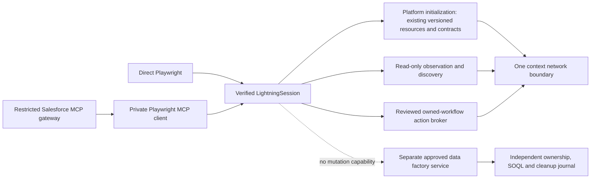

# Shared Salesforce Lightning session architecture

This increment continues `0849671` on `feature/verified-discovery`. It implements a reusable session owner over the existing policies and services. No individual Salesforce static URL or Aura operation was newly allowed. The real fully rendered Account milestone is **not complete**: no normal-session capture is available, the previous grant is expired/exhausted, and the prior trace still contains unreviewed platform contracts. No fresh Salesforce session, data run or model request was executed in this increment.

## Four planes, one context



| Plane | Implemented boundary | Authority it does not acquire |
|---|---|---|
| Platform initialization/resources | Existing exact org/user/persona/origin/state/build/app checks, versioned asset classes/cache, explicit source-backed request contracts, separately approved native exception and shared budgets | No get-prefix/wildcard Aura permission, agent step, form, arbitrary API, Apex, financial or administrative authority |
| Observation/discovery | Exact approved record navigation; native record-document proof; role counts and actually observed name-locator proposals; reviewed multi-element rendered-view checks | No arbitrary URL, raw snapshot/model upload, invented workflow, automatic locator repair or cleanup ownership |
| AI interactions | Only locally configured workflow IDs/steps, exact owned records, reviewed workflow/template hash, one-use action journal and existing network gate | No permission minting, arbitrary native MCP tool, submit/delete/payment exemption or factory access |
| Business mutations/high impact | Existing separate sandbox/dedicated data services, exact named approvals, deterministic factories, fresh identity, verification and owned cleanup | Platform readiness never grants mutation approval; high-risk operations remain disabled |

The kernel `attachReviewedBrowserContext` installs one boundary once per context, proves actual native identity/build and reserves one session. Reattachment cannot change policy/identity/state/transport or reserve a second session. The generated guard, existing probe, owned selector pipeline and managed service use it. Existing `SANDBOX_QA`, strict Production observation and controlled-Production rejection remain unchanged; a dedicated profile cannot be inherited by another mode/org.

`LightningSession` owns browser/context/Page handles, serializes commands, shares the original request/time/action budgets, closes at the approved duration and never auto-reopens. API JWT and browser authentication remain independent. Independent pre/post reference checks remain required; missing/changed checks cannot produce readiness evidence. Observation references never enter factory ownership.

## Engine and platform versioning

The existing Salesforce build/app/source versions and complete browser-plan hash remain. New managed profiles also bind an engine hash covering the installed test-driver version, exact MCP release and its driver dependency, Chromium/headless/nonpersistent context and restricted gateway. An upgrade requires a newly reviewed engine profile. Old signed plans are not rewritten or activated.

Actual integration testing found MCP 0.0.60 incompatible with the installed Playwright 1.65 context API. MCP is now pinned to **0.0.84**, whose published dependency is the 1.65 line. This fixes the new SDK integration; it does **not** explain the previous direct-Playwright Salesforce rendering failure. The real installed MCP server is exercised in integration tests, not replaced with a mock tool. There is one narrow structural type bridge between the SDKs; runtime compatibility is tested and failures close the context.

The SDK's custom-context API uses `isolated:false` to select the supplied context. This does not create a persistent browser profile: the owner has already launched headless Chromium and created a nonpersistent context. Asking that API for another isolated context fails and must not create an unguarded session. No CDP/debug endpoint is exposed.

MCP network allow-origin settings are **not** the security boundary. The private connection explicitly clears its origin lists to avoid installing a later `route.continue` handler over the framework gate. An integration test sets an MCP origin environment variable and schedules mutation/Apex attempts from page initialization; both remain blocked before the fixture backend. WebMCP discovery, code generation, unrestricted file access, automatic session capture and image responses are disabled. Native output is private under ignored state; raw responses are never forwarded to agents or RAG. `.playwright-mcp` and HAR artifacts are also ignored.

An SDK dependency can change which executable npm resolves. Tests and browser installation therefore explicitly use the `@playwright/test` CLI; the strict reportingLabs option schema was not relaxed to accept options injected by another runner.

## Playwright MCP gateway

The private MCP connection is created through the package's documented programmatic `createConnection(config, contextGetter)` API. Its only invoked native tools are `browser_navigate` and `browser_snapshot`, with host-constructed arguments. Native snapshots/console data stay behind the gateway; exported evidence consists of hashes, counts and status.

External clients receive only:

- `sfqa_browser_observe_record`: choose an already approved Account/Contact reference, with no arbitrary URL.
- `sfqa_browser_discover_view`: collect bounded role counts and observed locator candidates using the API-verified record name as a private value binding.
- `sfqa_browser_reviewed_view`: check a locally reviewed source/build-bound rendering contract.
- `sfqa_browser_reviewed_step`: choose a configured reviewed owned-workflow ID/step; observation grants cannot use it.
- `sfqa_browser_status`: read safe status and capability-plane descriptions.

Native evaluate/run-code/navigation/click/upload/network tools, cookies, file paths, credentials and approval-writing methods are not exposed. Workflow execution remains the existing action broker; it cannot gain writes through platform initialization.

## Rendered view and data-lifecycle order

A record document HTTP 200, an empty Lightning shell, a successful bootstrap or one name match is insufficient. A reviewed view binds exact org-source/build/app/engine context through the approved plan, an actual record-name locator, distinct visible content locators, observed loading/error indicators and a stability interval. Every locator is source-reviewed; the framework inserts no guessed Salesforce selector.

Name expectations come from the approved reference API, not a model. Duplicate/ambiguous selectors, busy/fault states, a content locator aliasing the name node, changed outcomes and version/operator mismatches fail. Shared typed role/label/test-ID/**exact text** locators now resolve identically in discovery, generation, guarded steps and fixture exploration. This is an added reviewed locator type, not an automatic repair or weaker assertion.

Only a successful observation-only Account view followed by an unchanged independent reference check can create a local readiness receipt. It binds source/build/app/state/engine/view/initialization scope, operator, validation class and at most 15 minutes within the original grant. It grants **no mutations** and is not a verified business lesson. An offline receipt cannot unlock a live run.

New engine-profile data lifecycles must reference this receipt before planning/reservation and again immediately before data setup. Existing factory/UI/session approvals, fresh schema/API/native preflight, exact run ownership, actual generated tests, independent SOQL, reverse cleanup and reportingLabs remain. Contact workflow verification still requires its own reviewed selectors. Legacy approved flows remain compatible; this stronger prerequisite applies to the new managed profile.

## Normal-session baseline: provenance before comparison

The operator confirmed **no capture** is currently available. The previous routed `native-reference` is a policy-matched transport reference, not normal authenticated Lightning. [Playwright documents that routing disables its HTTP cache](https://playwright.dev/docs/api/class-browsercontext#browser-context-route); do not use that routed trace to claim normal-cache equivalence or a proven cause.

The normal import path requires a headless Playwright capture declaration attesting that framework routing was absent, exact driver version, capture time/evidence hash, named review, HAR byte hash and matching native Account/Contact document org/user/build/app evidence. Raw captures stay inside `.auth`/`.state`, bounded to 64 MiB. A successful unrelated document or wrong identity/build is rejected. Native identity evidence from a file is explicitly distinguished from fresh network proof. Transport configuration is operator-attested, not inferred from HAR alone.

Import/compare sends no request, grants no request authority, proves no server purity and cannot label a view rendered. HTTP 200 Aura ERROR is not success; comparison keeps root cause unresolved until independently investigated. There is deliberately no unrestricted Salesforce launcher to manufacture a baseline while silently allowing unknown Aura operations. A reviewed platform initialization profile or an independently authorized normal capture is still needed.

## Operator commands

```powershell
npm.cmd run browsers:install
npm.cmd run typecheck
npm.cmd run unit
npm.cmd run demo
npm.cmd run demo:graph
npm.cmd run platform -- demo-learning
npm.cmd test
```

Prepare an inactive architecture review from a private input with `sourceReview`, independently approved `statePath`, **fresh** `runId` and optional actual `viewPath`:

```powershell
npm.cmd run platform -- lightning-review .state/lightning-architecture-input.json
```

Outputs are `.state/lightning-architecture.review.json` and a safe summary. Source resources/contracts are reused, not widened; all approval operators become `REVIEW_REQUIRED`. Missing actual selector review and normal baseline remain explicit. Preparation performs no Salesforce call, session reservation, grant activation, factory renewal or quota increase.

Only after exact approval, fresh independent authentication and required platform review:

```powershell
npm.cmd run platform -- lightning-observe .state/APPROVED_PROFILE.json .auth/APPROVED_STATE.json --view .state/REVIEWED_VIEW.json --via playwright
# Or use the same service through the restricted MCP gateway:
npm.cmd run platform -- lightning-observe .state/APPROVED_PROFILE.json .auth/APPROVED_STATE.json --view .state/REVIEWED_VIEW.json --via mcp
# A separately configured MCP client can connect to this stdio entrypoint:
npm.cmd run platform -- lightning-mcp .state/APPROVED_PROFILE.json .auth/APPROVED_STATE.json --view .state/REVIEWED_VIEW.json
```

These examples consume approved slots; do not run both against an exhausted grant. For an independently authorized normal capture:

```powershell
npm.cmd run platform -- lightning-baseline-review .auth/NORMAL.har .state/PROFILE.json --capture .state/CAPTURE_DECLARATION.json
# Review/approve the exact local receipt before import or comparison.
npm.cmd run platform -- lightning-baseline-import .auth/NORMAL.har .state/PROFILE.json --receipt .state/APPROVED_BASELINE_RECEIPT.json
npm.cmd run platform -- lightning-baseline-compare .auth/NORMAL.har .state/PROFILE.json --receipt .state/APPROVED_BASELINE_RECEIPT.json --trace .state/CONTROLLED_TRACE.json
```

The earlier source cache/correlation tools remain. No individual Aura request was newly permitted in this increment. The next real milestone remains a fully rendered, selector-validated Account without mutation, followed by a fresh reviewed Account/Contact lifecycle. Broader visual QA/autonomy/connectors/analytics and all cumulative requirements remain in the feature matrix.
